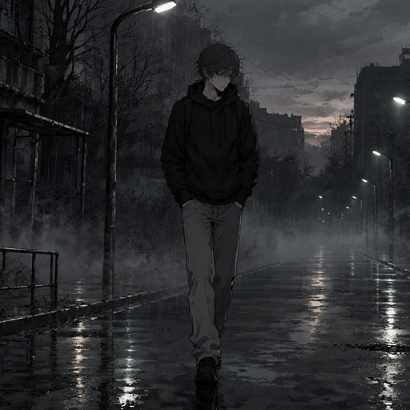
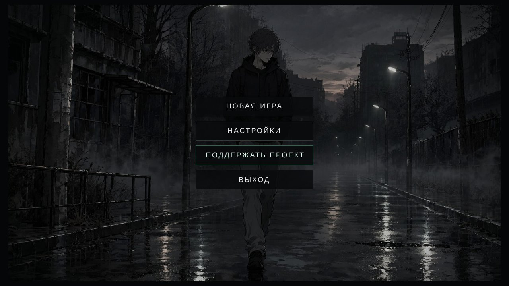
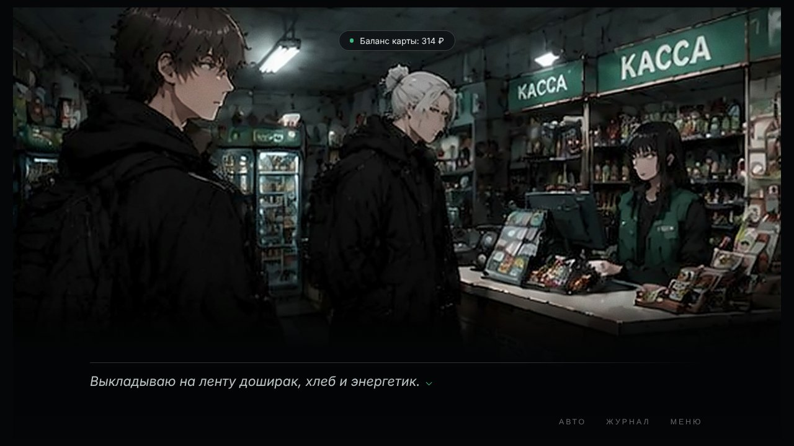
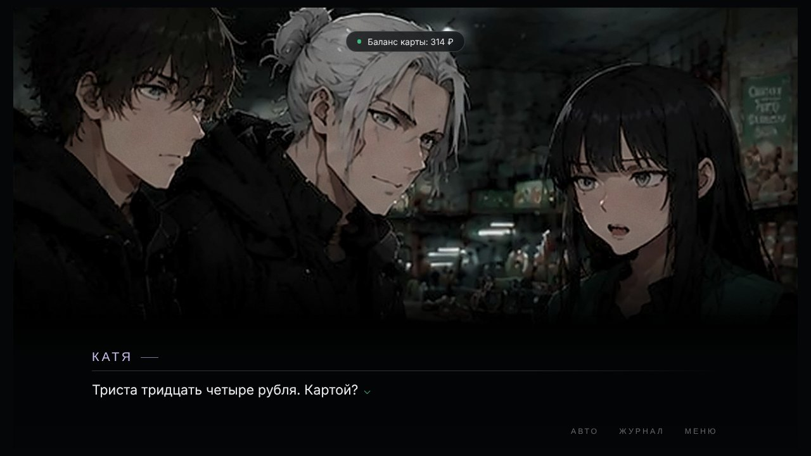
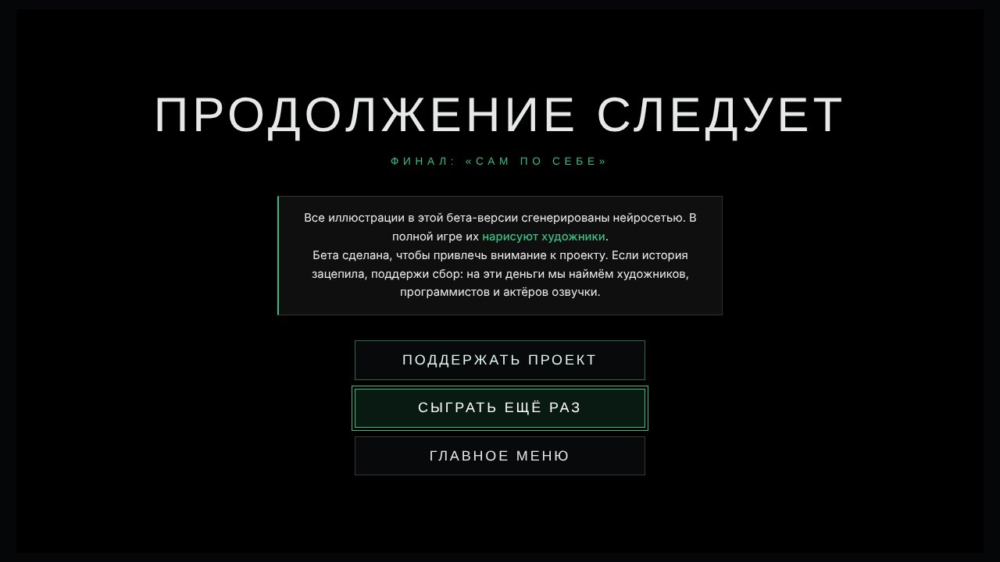

<h1 align="center">Navella</h1>

<b>Визуальная новелла про Петербург, 20 рублей и людей, которых не ждёшь.</b>

---

Петербург, Васильевский остров, декабрь 2023. Диме 21, он только что выучился на программиста, у него нет друзей, зато есть уверенность, что он справится сам. А потом на кассе «Пятёрочки» ему не хватает двадцати рублей.

**Бета · Глава 1:** два игровых дня, развилки, три концовки. Проходится за 20–30 минут.

## ⬇️ Скачать бесплатно

| Платформа | Файл |
|---|---|
| 🪟 **Windows**, без установки | [Navella-Portable.exe](https://github.com/GallonNnnn/Navella-download/releases/latest) |
| 🪟 **Windows**, установщик | [Navella-Setup.exe](https://github.com/GallonNnnn/Navella-download/releases/latest) |
| 🤖 **Android** | [Navella-beta.apk](https://github.com/GallonNnnn/Navella-download/releases/latest/download/Navella-beta.apk) |

Все версии и история обновлений: **[Releases](https://github.com/GallonNnnn/Navella-download/releases)**

> **Windows** может показать окно «Windows защитила ваш компьютер»: у беты нет платной цифровой подписи. Нажмите «Подробнее» → «Выполнить в любом случае».
> **Android** попросит разрешить установку из неизвестных источников.

## Скриншоты

## ⚠️ Об иллюстрациях

Все иллюстрации в бете сгенерированы нейросетью. Бета сделана, чтобы показать историю и привлечь внимание к проекту. В полной версии весь арт нарисуют художники.

## 💚 Поддержать проект

Собранные деньги пойдут на художников, программистов и актёров озвучки:
**[donationalerts.com/r/rinnin](https://www.donationalerts.com/r/rinnin)**

---
© Gallon. Все права защищены. Исходный код игры закрыт.
